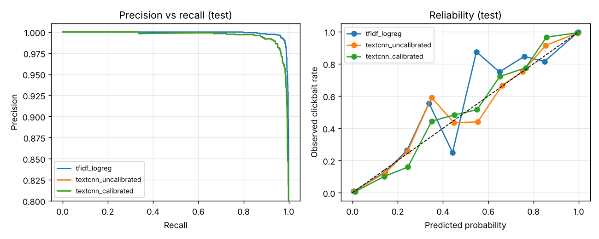

# Content Quality Classifier

A clickbait detector for headlines, built as the content quality signal for my
[content-recsys](https://github.com/vaibenz/content-recsys) project. The question it serves:
a feed ranked purely on clicks drifts toward clickbait, so how much engagement do you give up
to show people more substantive content?


## Results

Test set of 3,200 held out headlines (numbers from `results/RESULTS.md`, reproducible with `make run`):

| Model | F1 | ROC AUC | ECE | Recall at 98% precision target |
|---|---|---|---|---|
| TF-IDF word + char n-grams, logistic regression | 0.986 | 0.998 | 0.006 | 98.3% |
| TextCNN (PyTorch, trained from scratch) | 0.969 | 0.996 | 0.009 | 93.7% |

The simple model wins. On short, stylised text with 26k training examples, character n-grams
capture almost everything a small neural net learns, train in seconds, and are easy to explain.
That is the model I ship to the recommender.

### The finding I found most useful: a casing shortcut

The clickbait sources write in Title Case and most news sources do not. A model trained on raw
casing scores F1 0.995, higher than the honest model, but when the same test headlines are
lowercased it collapses to F1 0.020. It had learned the publishers' style guides, not what
makes a headline clickbait. The pipeline lowercases everything, trading half a point of
benchmark F1 for a model that might survive contact with a new source.

The strongest remaining features show the same risk at a smaller scale: `knicks`, `mets`, `uk`
and `obama` push toward "not clickbait" because the news side comes from the New York Times and
The Guardian. Topic and source are still partly confounded with the label, which is why I
would not trust these numbers on a new platform without fresh labels.

## How it works

1. Data. [Chakraborty et al. (2016)](https://github.com/bhargaviparanjape/clickbait):
   16k clickbait headlines (BuzzFeed, Upworthy, ViralNova, ...) and 16k news headlines (WikiNews,
   NYT, The Guardian, The Hindu). De-duplicated, lowercased, stratified 80/10/10 split.
2. Baseline. TF-IDF over word 1 to 2 grams and character 2 to 5 grams, logistic regression,
   with regularisation strength chosen on validation log loss.
3. TextCNN. Convolutions of width 2, 3 and 4 over learned embeddings, max pooled, with early
   stopping on validation loss and temperature scaling for calibration.
4. Threshold. Demoting a good article as clickbait hurts a creator more than letting one
   clickbait through, so the operating threshold is set on validation to reach 98% precision,
   then reported once on test.
5. Optional DistilBERT. `quality/finetune.py` fine-tunes `distilbert-base-uncased` on the same
   splits (`make distilbert`, best on a Colab GPU).

Calibration matters here because the recommender subtracts `lambda * P(clickbait)` from ranking
scores. A probability of 0.8 needs to mean roughly 80%, or lambda means nothing.



## Run it

```bash
pip install -r requirements.txt
make run          # downloads the data (about 700 KB), trains both models, writes results/
make test
make score-mind   # scores MIND titles for content-recsys (clone it next to this repo first)
```

## What it doesn't do (yet)

* The dataset is near ceiling. Real platform quality (thin content, misleading thumbnails,
  engagement bait in the body text) is much harder than headline style.
* Domain shift. The model is trained on pre 2017 headlines from a handful of publishers and applied to 2019 MSN News
  titles in MIND. `score_mind.py` prints the score distribution by category so you can check that
  it is not, for example, flagging all lifestyle content.
* Clickbait is a proxy for quality, not the whole thing.

## Where things live

```
quality/data.py       download, normalise, split
quality/baseline.py   TF-IDF + logistic regression
quality/textcnn.py    TextCNN and temperature scaling
quality/evaluate.py   F1, ROC/PR AUC, Brier, ECE, precision targeted threshold
quality/finetune.py   optional DistilBERT fine-tuning
scripts/run_all.py    trains everything, writes results/
scripts/score_mind.py scores MIND news titles for the recommender
```

---

If something here is unclear, broken, or just wrong, feel free to open an issue. I'm always happy to chat about it.
